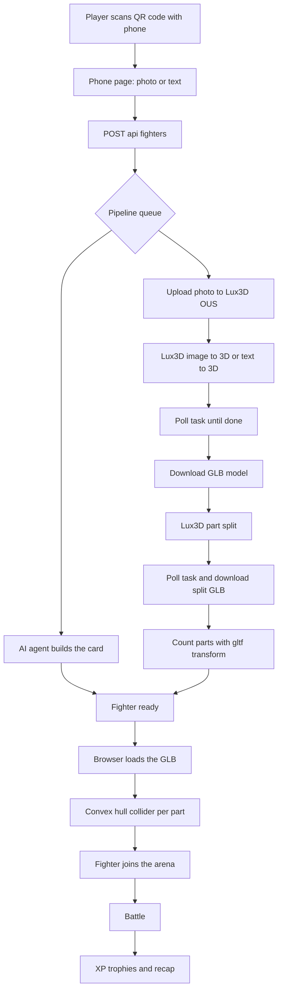
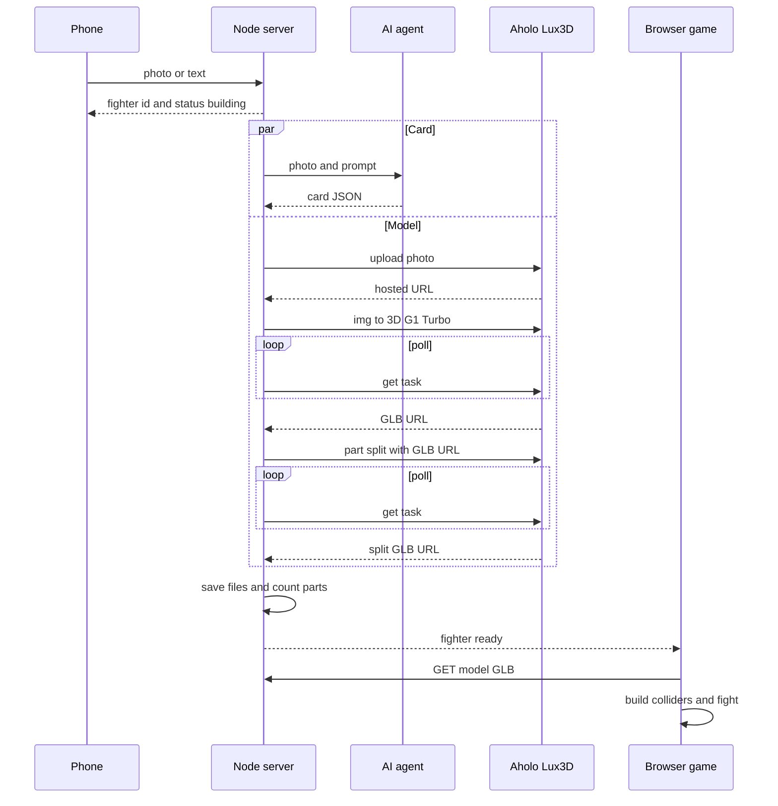
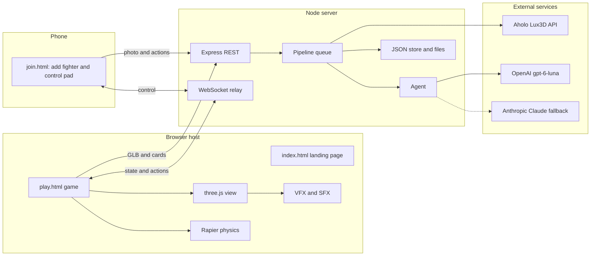

# Junk Drawer Arena

**Snap a photo of any object at home. It becomes a 3D fighter made of its real parts. Then it battles in a physics arena where hard hits break those parts off.**

Built for the **Manycore Aholo Global 3D AI Hackathon**. The game runs in the browser. Players join and control fighters from their phones.

A mug, a rubber duck, a frying pan and a shoe walk into an arena. Only one walks out with its handle still on.

---

## Table of contents
1. [What it is](#what-it-is)
2. [How Aholo Lux3D is used](#how-aholo-lux3d-is-used)
3. [Full workflow](#full-workflow)
4. [Architecture](#architecture)
5. [Integrations](#integrations)
6. [Game design](#game-design)
7. [Physics and effects](#physics-and-effects)
8. [Project structure](#project-structure)
9. [Run it](#run-it)
10. [Configuration](#configuration)
11. [HTTP and WebSocket API](#http-and-websocket-api)
12. [Deploy](#deploy)
13. [Credits and costs](#credits-and-costs)
14. [Troubleshooting](#troubleshooting)

---

## What it is

| Step | What happens |
|---|---|
| 1. Capture | Take a photo of a real object with your phone. Or type a short description. |
| 2. Build 3D | Aholo Lux3D makes a textured 3D model from the photo or text. |
| 3. Split | Lux3D part split cuts the model into its real parts such as handle, lid and legs. |
| 4. Card | An AI agent reads the photo and writes a fighter card: name, material, real size and mass, stats, element, signature move and taunts. |
| 5. Battle | 2 to 4 fighters fight in a physics arena. Each real part has HP. Broken parts fly off as debris. |
| 6. Grow | Winners earn XP and trophies. Cards level up. New arenas unlock. |

The game also has a landing page, a sign in and sign out flow, a pause menu, sound, live commentary, a match recap and a clip recorder.

---

## How Aholo Lux3D is used

The game cannot work without Lux3D. It is the core of every real fighter.

| Lux3D API | Used for |
|---|---|
| OUS asset upload (`/asset/v1/token` and `ous/api/v2/single/upload`) | Uploads the player photo and gets a hosted URL |
| `img-to-3d` (G1-Turbo with PBR) | Turns the photo into a textured GLB model |
| `text-to-3d` | Turns a typed description into a GLB model |
| `part-split` | Splits the GLB into real parts. Each part becomes its own collider with HP |
| `generate/task/get` | Polls every task until it is done or failed |
| `account/balance` | Shows remaining credits in the app |

Why part split matters: in most games a model is one shape. Here the mug handle is a real part. It can be hit. It can break off. The fighter then plays differently without it.

---

## Full workflow



Detail of one fighter build:



The pipeline keeps a queue. Lux3D allows one task per account at a time, so the server runs 3D jobs one after another. The card builder runs at once so the player sees a card while the model is still building.

---

## Architecture



**Layers**

| Layer | Tech | Job |
|---|---|---|
| Landing and game UI | Vite, plain JS, CSS | Store style landing page, deck and garage, HUD, pause menu |
| 3D view | three.js 0.170 with bloom | Arena, fighters, effects |
| Physics | Rapier (WASM) | One rigid body per fighter, convex hull per part, debris bodies |
| Server | Node 22, Express, ws, multer | REST API, WebSocket relay, pipeline queue |
| Model tools | `@gltf-transform/core` | Counts meshes and parts in the GLB on the server |
| Storage | JSON file and folders | `data/fighters.json` and `data/fighters/<id>/` |
| Progress | Browser localStorage | Profile name, trophies, XP and wins |

---

## Integrations

### Aholo Lux3D (required for real fighters)
Wrapped in `server/aholo.js` by the `AholoClient` class. It handles auth, retries, error mapping, upload, task create, task polling and download. Output links expire after about 2 hours, so the server downloads each GLB at once.

### OpenAI (agent, preferred)
Model `gpt-6-luna`. It reads the photo and returns a strict JSON card. It also writes the match recap. Set `OPENAI_API_KEY`.

### Anthropic Claude (agent, optional fallback)
Used when there is no OpenAI key but `ANTHROPIC_API_KEY` is set.

### Rules builder (no key)
If no agent key is set the game still works. A rules based builder makes the card from the text or file name. This keeps the demo playable with zero setup.

Agent order: **OpenAI, then Anthropic, then rules builder.**

### Phone controller
The phone opens `join.html` over the local network. A QR code on the host screen points to it. The page lets players add a fighter and then control it with Attack, Jump and Dodge buttons. Actions travel over the WebSocket.

---

## Game design

### The fighter card
Every card has a name, material, real size and mass, stats that always add up to **24**, a signature move, an element and taunts. Real mass and size change how the fighter moves and hits in the arena.

### Energy
Each fighter has up to 10 energy and starts with 4. Moves cost energy. Regen is faster for fast fighters.

| Move | Cost |
|---|---|
| Attack | 4 |
| Jump | 2 |
| Dodge | 3 |

### Elements
The agent picks an element from the object material. A rules fallback maps words to elements.

| Element | Typical objects | Perk |
|---|---|---|
| Fire | wood, candles, pans | Special move burns the target for 2 seconds |
| Water | glass, rubber, bottles | Gets 1 energy back when hit |
| Lightning | metal, batteries | Special move hits 25 percent harder |
| Air | fabric, foam, shoes | Dodge costs 2 and jumps go higher |
| Earth | ceramic, stone, plants | Takes 15 percent less damage |

### Rarity
| Rarity | How you earn it |
|---|---|
| Starter | Built in demo fighter |
| Common | Made from text with no 3D model |
| Rare | Real Lux3D model |
| Epic | Model with part split |
| Legendary | Part split with 5 or more parts |

### Weight class
Set by real mass: **Light** under 0.2 kg, **Middle** under 1.2 kg, **Heavy** above that.

### Levels and trophies
* Cards gain a level every 3 XP. Max level is 10. Each level adds 5 percent HP.
* The leader of the winning side gains 30 trophies. A loss costs 12.
* Arenas unlock at 0, 200, 500, 900 and 1400 trophies.

### Match rules
* Fighters are shielded at the core while other parts are attached. Core hits do 55 percent less damage until parts are gone.
* Falling below the floor is a ring out.
* After 45 seconds the arena shrinks.
* At 95 seconds the fighter with the most HP wins.
* AI drives every fighter. A human input from phone or keyboard takes control for 8 seconds.

---

## Physics and effects

**Physics (Rapier)**
* One rigid body per fighter with a convex hull collider for each part.
* Each part has HP. Hard hits break parts off as debris bodies.
* Slams aim using flight time. Edge steering keeps AI fighters from falling off too easily.
* The simulation lives in `client/src/sim.js` and also runs headless for balance tests.

**Effects**
* Particle pool shader with rings, lightning bolts, rocks and swoosh arcs per element.
* Anime style hits: speed lines, a short freeze frame, camera shake and a screen flash.
* Bloom, element glow rings and trails for fast movement.
* Synthesized sound effects and live commentary. A recorder saves a clip of the fight.

---

## Project structure

```
Junk-Drawer-Arena/
├─ client/
│  ├─ index.html          Landing page
│  ├─ play.html           Game shell
│  ├─ join.html           Phone page
│  ├─ public/img/         Hero image
│  └─ src/
│     ├─ main.js          Game controller and UI
│     ├─ sim.js           Rapier simulation and rules
│     ├─ arena.js         three.js arena view
│     ├─ fighter.js       GLB loading and part colliders
│     ├─ procedural.js    Demo fighters and placeholder shapes
│     ├─ elements.js      Element data and perks
│     ├─ vfx.js           Particle and effect system
│     ├─ sfx.js           Sound
│     ├─ meta.js          Profile, XP, trophies, rarity
│     ├─ commentary.js    Live commentary
│     ├─ recorder.js      Clip recorder
│     ├─ phone.js         Phone controller
│     ├─ net.js           WebSocket client
│     ├─ landing.js       Landing page logic
│     ├─ landing.css      Landing page style
│     └─ style.css        Game style
├─ server/
│  ├─ index.js            Express routes and WebSocket relay
│  ├─ pipeline.js         Job queue for card and 3D build
│  ├─ aholo.js            Lux3D client
│  ├─ agent.js            Card builder and recap writer
│  └─ store.js            JSON store
├─ scripts/
│  ├─ check-keys.js       Tests your keys
│  ├─ seed.js             Makes sample fighters through Lux3D
│  └─ sim-test.js         Headless balance test
├─ vite.config.js
├─ package.json
└─ .env.example
```

---

## Run it

You need **Node 20 or newer**.

```bash
git clone https://github.com/Prasannaverse13/Junk-Drawer-Arena.git
cd Junk-Drawer-Arena
npm install
cp .env.example .env     # on Windows: copy .env.example .env
# add your keys to .env
npm run check            # tests the keys
npm run play             # builds and serves on http://localhost:8787
```

1. Open `http://localhost:8787`.
2. Sign in with a name. This only saves progress in your browser.
3. Press **Play free**.
4. Scan the QR code with a phone on the same Wi-Fi. Or open `http://<your-pc-ip>:8787/join.html`.
5. Take a photo of an object and add it as a fighter.

No keys yet? Press **Quick demo**. Five built in demo fighters play with no setup.

### Controls
| Input | Action |
|---|---|
| Phone | Attack, Jump, Dodge buttons |
| Keyboard, fighter 1 | Q W E |
| Keyboard, fighter 2 | I O P |
| P or Esc | Pause |

### Useful commands
| Command | What it does |
|---|---|
| `npm run play` | Build and serve |
| `npm run dev` | Server and Vite with hot reload (open port 5173) |
| `npm run check` | Test Aholo and OpenAI keys |
| `npm run seed` | Make 4 text fighters through Lux3D |
| `npm run simtest` | Headless balance test |

---

## Configuration

Copy `.env.example` to `.env`. Never commit `.env`.

| Variable | Default | Meaning |
|---|---|---|
| `AHOLO_API_KEY` | none | Lux3D key from labs.aholo.ai. Raw key with no Bearer prefix |
| `OPENAI_API_KEY` | none | Agent key. Optional but recommended |
| `OPENAI_MODEL` | `gpt-6-luna` | Agent model |
| `ANTHROPIC_API_KEY` | none | Optional fallback agent |
| `ANTHROPIC_MODEL` | `claude-sonnet-5-5` | Fallback model |
| `LUX3D_VERSION` | `G1-Turbo` | `G1-Turbo` is fast. `G1` is best quality |
| `LUX3D_PART_SPLIT` | `1` | Set `0` to skip part split and save credits |
| `LUX3D_FACE_COUNT` | `20000` | Mesh size sent to Lux3D |
| `PORT` | `8787` | Server port |

---

## HTTP and WebSocket API

| Route | Method | Purpose |
|---|---|---|
| `/api/status` | GET | Key status, credits, agent provider, LAN addresses, split setting |
| `/api/fighters` | GET | List fighters |
| `/api/fighters` | POST | Create a fighter from a photo upload or text |
| `/api/fighters/:id` | DELETE | Remove a fighter |
| `/api/fighters/:id/retry` | POST | Run a failed build again |
| `/api/recap` | POST | Write a match recap |
| `/files/...` | GET | Saved photos and GLB models |
| `/ws` | WebSocket | Relay between the host screen and phones: join, actions and match state |

---

## Deploy

The game needs a **long running Node server** for the WebSocket and for saved fighter files. Use a host that runs Node servers such as Render, Railway or Fly. Vercel runs short serverless functions. It can host the landing page but not the full game.

Render example:
* Build command: `npm install && npm run build`
* Start command: `npm start`
* Environment: `AHOLO_API_KEY`, `OPENAI_API_KEY`
* Add a persistent disk for `data/` if you want fighters to survive restarts.

---

## Credits and costs

| Item | Lux3D credits |
|---|---|
| Turbo model | 1 |
| Part split | 30 |
| One full fighter | about 31 |

With 300 credits you can build about 9 full fighters. Set `LUX3D_PART_SPLIT=0` to save credits. The game then cuts the mesh into chunks with k-means by itself.

---

## Troubleshooting

| Problem | Fix |
|---|---|
| `OpenAI key failed: HTTP 401` | The key is wrong or expired. Make a new one. The game still works with the rules builder |
| Lux3D task never finishes | Lux3D runs one task at a time per account. The server queues them. Wait or press retry |
| Model link expired | Links last about 2 hours. Retry the fighter |
| Phone cannot open the page | Phone and PC must be on the same Wi-Fi. Allow Node through the firewall |
| Blank page after `npm run dev` | Open port 5173 for dev. Use 8787 for `npm run play` |
| Fighters gone after restart on a host | Add a persistent disk for `data/` |

---

## Built with

Aholo Lux3D, OpenAI, three.js, Rapier, Vite, Express, ws, gltf-transform.

Made by [Prasannaverse13](https://github.com/Prasannaverse13) for the Manycore Aholo Global 3D AI Hackathon.
